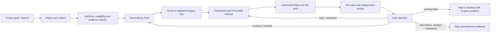

# Kiến trúc Orchestrator_Reverse

## Luồng điều phối

Đây là mô hình đích. Prompt Stack trong repository chưa được nối thành runtime workflow.

## Trách nhiệm theo lớp

| Lớp | Trách nhiệm |
|---|---|
| Intake/context | Lưu mục tiêu, phạm vi, tiêu chí, quyết định đã biết, ambiguity và context revision. |
| Orchestrator | DAG, dependency, chọn registered owner, điều kiện mở/dừng, checkpoint và handoff. |
| Broker/authority | Xác minh actor, action, target, component, scope, capability và approval. Prompt không thay enforcement. |
| REA workflow/evidence | Evidence node, provenance, tool/session receipts, ledger và handoff history. |
| IDA provider/database | Native/decompiler observations, slice/coordinates, database revision/state và capability thực. |
| Knowledge | Bundle được phép dùng, source/version/locator/applicability và ACK theo từng consumer. |
| Evaluation/gate | Frozen criteria/oracles, raw attempt capture, reviewer grading và gate result có provenance. |

## Sáu role đã đăng ký

| Role | Phạm vi |
|---|---|
| Prompt-Master | Phân rã yêu cầu, tạo DAG/prompt và đề xuất routing trong quyền hiện có. |
| Triage-Sentinel | Reconnaissance cấu trúc tĩnh và triage; không decompile sâu hoặc sửa IDB. |
| Decomp-Analyst | Đọc disassembly/decompiler/CFG/xrefs; đề xuất semantic/type claims có evidence. |
| Crypto-Logic-Specialist | Phân tích algorithm khi input evidence đủ phù hợp; không dispatch mặc định. |
| Evidence-Synthesizer | Kiểm nguồn, trạng thái evidence, conflict và handoff. |
| Product-Evolution-Architect | Chuyển yêu cầu sản phẩm và evidence thành proposal/acceptance plan. |

HITL executor giữ quyền phê duyệt/thay đổi được cấp riêng. Debate là service review có điều kiện. Hai khái niệm này không tự tạo thêm identity.

## Bảo toàn REA–IDA qua tám boundary

Áp cùng một invariant từ intake/context; task DAG; routing/prompt/knowledge; broker/tool; evidence/handoff; checkpoint/attempt/resume; testcase/oracle/evaluation; tới acceptance/continuation.

Mọi target consumer cần binding liên quan đến cùng target, component, slice và IDB state; REA/IDA producer, phiên, revision, custody và freshness; consumer validation, relevance và ACK riêng. Khi upstream state đổi, invalidate evidence và ACK phụ thuộc rồi revalidate. Không cần gọi lặp cả hai engine nếu receipt kế thừa còn hợp lệ và đã được kiểm lại.

Với chuẩn bị ngoài target: pair để null, status `NOT_RUN`, chỉ ghi custody. Không phát biểu về target. Thiếu pair chặn target consumption/completion, còn acquisition chỉ được thực hiện khi có scope/authority độc lập phù hợp.

## Routing và state

- Hash/provenance mismatch của binding đang xét: reject binding đó và giữ expected/actual.
- Thiếu quyền, capability, pair hoặc gate cần thiết: `BLOCKED` ở nhánh phụ thuộc.
- Goal mơ hồ có ảnh hưởng lựa chọn: hỏi phần còn thiếu hoặc `WAIT_INPUT`.
- Evidence mâu thuẫn nhưng toàn vẹn: chuyển review; không ép consensus.
- Không có owner sau khi prerequisite đã sẵn sàng: `NO_MATCH`.
- Một owner chỉ được chọn khi đủ mọi prerequisite; nhiều owner thì áp precedence đã review hoặc giải quyết ambiguity.
- Retry phải có attempt mới, budget hữu hạn và bằng chứng tiến triển. Hết budget hoặc lặp lỗi không tiến triển thì dừng.

Checkpoint chỉ là snapshot điều khiển. Khi context/source/IDA revision thay đổi, tạo revision mới, invalidation downstream và lưu lịch sử bất biến. Không đánh dấu `Verified` chỉ vì đọc được checkpoint.
