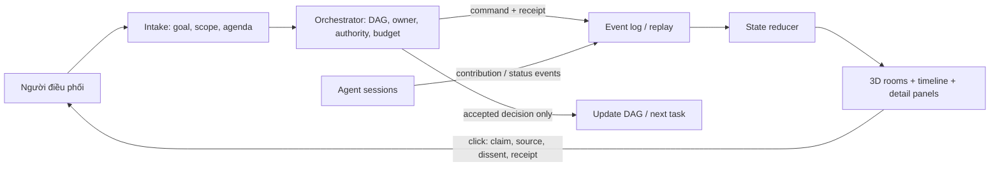

# Kiến trúc trải nghiệm và semantics cuộc họp

## Nguyên tắc

Orchestrator là nguồn quyết định. Giao diện 3D chỉ chiếu trạng thái đã được ghi thành event. Event log/timeline cung cấp bằng chứng; animation giúp nhìn nhanh ai đang ở đâu và luồng công việc đang đi thế nào.

## Mô hình trạng thái cần tách

Một trường `status` duy nhất không đủ. Agent có thể đang làm task nhưng không online, đang chờ người điều phối trong khi job khác chạy, hoặc được mời họp khi còn bận.

| Trục | Giá trị khởi đầu đề xuất | Ý nghĩa |
|---|---|---|
| `work_status` | `unassigned`, `assigned`, `working`, `waiting`, `blocked`, `completed`, `failed`, `cancelled` | Tình trạng của task/attempt, không phải animation. |
| `location` | `desk`, `meeting_room`, `waiting_area`, `corridor`, `offscreen` | Vị trí trình bày. Chỉ đổi khi có event thích hợp. |
| `presence` | `live`, `stale`, `disconnected`, `unknown` | Chất lượng kết nối/heartbeat. Không suy `working` từ avatar còn trên màn hình. |
| `meeting_status` | `proposed`, `invited`, `accepted`, `declined`, `deferred`, `joined`, `contributed`, `left`, `cancelled`, `complete` | Trạng thái cuộc họp và từng participant. |

Tên trên đây là vocabulary đề xuất cho prototype; **chưa phải schema đã được chấp nhận**.

## Mô phỏng luồng cuộc họp

1. Người điều phối nhập topic, mục tiêu, agenda, điều cần quyết định, tiêu chí hoàn tất, participant mong muốn và giới hạn thời gian/ngân sách.
2. Orchestrator kiểm tra scope, owner/capability và trạng thái bận. Hệ tạo `meeting_id`, ghi yêu cầu và gửi invite; UI chỉ hiện đã mời sau event `meeting.invited`.
3. Agent chấp nhận, từ chối hoặc hoãn. Agent đang `working` không bị kéo khỏi task ngầm. Orchestrator chờ, chọn phương án thay thế theo rule đã duyệt hoặc báo `BLOCKED`.
4. Người tham gia vào phòng khi có `meeting.joined`. Mỗi lượt gửi một contribution có cấu trúc: `position`, `claims`, `evidence_refs`, `risks`, `uncertainty`, `questions`. Reviewer có thể gửi `objection` gắn tới claim/event cụ thể.
5. Orchestrator tổng hợp: `agreements`, `disagreements`, `unsupported_claims`, `open_questions`, `decision_candidate`, `actions`. Không ép consensus khi evidence mâu thuẫn. Nếu decision cần human approval theo scope/gate, summary hiển thị `PENDING_HUMAN_DECISION` cho tới khi có receipt.
6. Orchestrator quyết định bước tiếp: cập nhật DAG khi điều kiện đã thỏa; nếu chưa, giữ task ở `WAIT_INPUT`, `BLOCKED`, `CONFLICT` hoặc chuyển human review. Ghi receipt, participant, outputs và next owner.
7. Khi meeting kết thúc, nhân vật về vị trí mới chỉ theo event kết thúc/return. Task đang dở vẫn giữ trạng thái riêng.

## Chuyển động nhân vật có ý nghĩa

- Khi người điều phối gửi lệnh, UI hiển thị lệnh, meeting/task ID và kết quả routing trong timeline trước; agent chỉ bắt đầu đi sau event phân công hoặc nhận invite có receipt.
- Agent được mời nhưng chưa accept ở khu chờ/vị trí hiện tại với dấu `INVITED`; agent bận/defer không bị kéo khỏi bàn hoặc làm mất task.
- Khi `meeting.joined` tới, nhân vật đi theo waypoint tới ghế được cấp. Bước vào phòng họp thể hiện participant thật sự đã tham gia, không phải lệnh mới.
- Khi `meeting.contribution_submitted`, người đang nói có cử chỉ/bong bóng ngắn; các agent khác hướng về người nói. Objection nối trực quan tới claim gốc, còn nội dung đầy đủ mở trong panel khi click.
- Khi Orchestrator gửi synthesis/decision, UI ghim bảng tổng kết có agreement, dissent, open questions và action items. Không thêm avatar “Orchestrator” vì Orchestrator là chức năng điều phối, không phải identity thứ bảy.
- Motion đang chạy không tự chứng minh công việc đã bắt đầu/kết thúc; source timeline vẫn là nơi xem event/receipt tương ứng.

## Nội dung bấm để xem

Mỗi avatar có thể mở panel với identity role hiện có, task/attempt, trạng thái theo ba trục, lệnh đã nhận, contribution, phản biện và receipt. Mỗi nội dung phải hiện nguồn/locator hoặc ghi `NO_EVIDENCE_REF`; không chỉ hiện bong bóng chat thiếu provenance.

Panel cuộc họp nên có timeline lượt nói; chuyển nhanh giữa claim và phản biện; tổng hợp đồng thuận/bất đồng; quyết định cùng lý do/điều kiện; action items với owner và acceptance. Chỉ đưa lên nội dung agent đã xuất như contribution/artifact, không hiển thị private chain-of-thought hoặc transcript ngoài scope người dùng.

## Event contract candidate

Event append-only gợi ý gồm:

`event_id`, `seq`, `occurred_at`, `event_type`, `meeting_id?`, `task_id?`, `attempt_id?`, `agent_id?`, `caused_by?`, `work_status?`, `location?`, `presence?`, `payload_ref?`, `evidence_refs[]`, `source_revision`, `simulation_label`.

Các event cấp cao: `goal.accepted`, `task.assigned`, `agent.accepted`, `agent.status_changed`, `meeting.proposed`, `meeting.invited`, `meeting.accepted/declined/deferred`, `meeting.joined`, `meeting.contribution_submitted`, `meeting.objection_submitted`, `meeting.synthesis_submitted`, `meeting.decision_recorded`, `meeting.closed/cancelled`, `task.handoff_recorded`.

Contract này chưa được implement. Event receiver cần kiểm schema, idempotency, thứ tự, reconnect/resync và redaction trước khi cho UI dựng state. Unknown/missing event phải ra `unknown/stale`, không tự đổi thành success.

