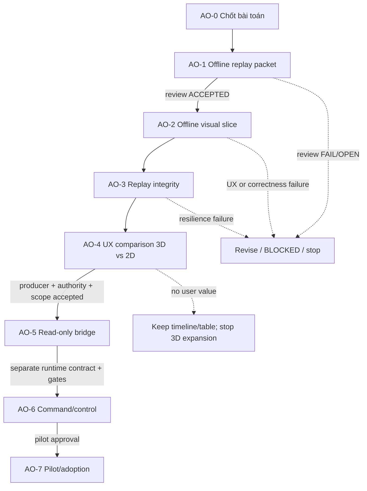

# Runbook điều phối roadmap văn phòng agent 3D

Đây là quy trình điều phối đề xuất cho roadmap `AGENT_OFFICE_PRODUCT_ROADMAP_01`. Nó không phải runtime router/capability hiện hành và chưa được dispatch.

## DAG cấp cao

## Cách tạo và chạy task

Mỗi node cần task packet với các trường: `task_id`, `roadmap_phase`, objective, scope, dependency IDs, input source/revision, owner identity, reviewer identity, deliverable, acceptance IDs, budget/limit hoặc `UNKNOWN`, risk, expected evidence, status, decision authority.

1. **Intake:** người điều phối xác nhận objective và AO phase; Prompt-Master lập atomic task/DAG. Nếu scope/budget/owner thiếu, ghi thiếu rõ và không tự đoán.
2. **Route:** chọn owner trong sáu identity hiện hữu theo capability/dependency. Reviewer khác owner khi cần độc lập. Không dispatch tới role không phù hợp.
3. **Execute:** chỉ trong scope được chấp nhận. AO-1/AO-2 là fixture/visual offline; mọi event mang `SIMULATED`. Không gọi model/provider/runtime.
4. **Review:** Evidence-Synthesizer kiểm source/revision/provenance, acceptance và conflict; Product-Evolution-Architect kiểm feature/UX khi liên quan. Findings gắn locator, verdict từng acceptance `PASS`, `FAIL` hoặc `OPEN`.
5. **Decision:** người điều phối quyết định `ACCEPTED`, `REVISE`, `BLOCKED` hoặc `STOP`. Reviewer không tự nâng gate hoặc mở phase runtime.
6. **Handoff:** ghi artifact/revision, acceptance result, unresolved dissent, dependency, decision maker và next atomic task. Chỉ phase được chấp nhận mới mở dependency kế.

## Áp dụng theo role hiện hữu

| Identity | Vai trò trong roadmap khi phù hợp |
|---|---|
| Prompt-Master | Intake, task packet, DAG/dependency, routing/stop, handoff |
| Product-Evolution-Architect | User scenario, product hypothesis, feature acceptance, UX review |
| Evidence-Synthesizer | Independent provenance/claim/revision/conflict/gate-semantic review |
| Triage-Sentinel | Chỉ khi có source/code recon cụ thể trong scope được giao |
| Decomp-Analyst | Chỉ khi có tác vụ decomp/native source phù hợp; không cần cho UI offline mặc định |
| Crypto-Logic-Specialist | Chỉ khi có nhánh algorithm liên quan; không mời mặc định |

Orchestrator là function điều phối; Debate là review có điều kiện; người dùng/người điều phối giữ quyền quyết định. Đây là mapping trách nhiệm proposal, không phải dispatch record.

## Bảng trạng thái roadmap hiện tại

| Phase | Status | Artifact/next dependency |
|---|---|---|
| AO-0 | `REVIEWED_CONDITIONAL_GO` | Profile + roadmap + review record |
| AO-1 | `PROPOSED_NOT_DISPATCHED` | `AGENT_OFFICE_OFFLINE_REPLAY_PACKET_01` |
| AO-2 | `BLOCKED_ON_AO1_ACCEPTANCE` | Chưa giao implementation |
| AO-3 | `BLOCKED_ON_AO2` | Chưa chạy fixture/tests |
| AO-4 | `NOT_STARTED` | Cần người thử, baseline và UX task |
| AO-5 | `BLOCKED_FUTURE` | Chưa có producer/permission/binding |
| AO-6 | `BLOCKED_FUTURE` | Chưa có runtime contract/authority/budget/gate readiness |
| AO-7 | `NOT_PLANNED_UNTIL_PREREQS` | Chưa có pilot authorization |

Không ghi `PASS` nếu chưa có evidence; không ghi `RUNNING` nếu task chưa được dispatch; không coi review đồng thuận là project acceptance.
