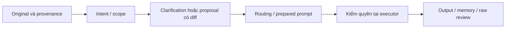

# Đề xuất input pipeline

**Cập nhật implementation 24/10:** [CLI local](../../guides/local-input-pipeline.md) đã triển khai/kiểm trong scope chuẩn bị input; [report](local-runtime-2026-10-24.md) và [state](../../../context/local-pipeline-state.json) là view của caller mới. Các mô tả NOT_IMPLEMENTED dưới đây giữ baseline thiết kế toàn sản phẩm; không dùng để phủ nhận leaf mới hoặc suy rằng phần còn lại đã chạy. [Native pilot](native-pilot-research-2026-10-24.md) mới nghiên cứu, chưa có target run.

**Trạng thái: PROPOSED / NOT_IMPLEMENTED / NOT_APPLIED.** Đây là thiết kế để review, chưa nối caller hoặc sản phẩm. Các bước dưới đây không tạo gate, schema, state hay identity mới và không cấp quyền thực thi.

Đọc [sáu tri thức nền](../../knowledge/input-pipeline/README.md) để xem nguồn và giới hạn; dùng [status v4](../input-support-gates/status-v4.json) làm mốc evidence. IMPLEMENTATION-C và EVALUATION-D vẫn 0/6 criterion hoàn tất; C6 chỉ có bằng chứng component một phần. Suite component 42 ca và suite checker 39 ca là hai phạm vi riêng, không là benchmark model hoặc input pipeline.

## Luồng đề xuất và trách nhiệm

Sơ đồ là luồng thiết kế để review; các boundary caller/runtime chưa triển khai:

Các owner trong bảng là trách nhiệm của [sáu identity hiện hữu](../../architecture/agents.md), chưa là dispatch record.

| Bước | Cần làm khi triển khai | Owner trách nhiệm | Đã có / còn thiếu |
|---|---|---|---|
| Original và provenance | Lưu original trước chuyển đổi, giữ locator/revision/digest và nguồn từng phần input | Prompt-Master; Evidence-Synthesizer review provenance | Candidate có request digest và input bindings. Immutable original store, storage receipt và lineage tại caller: NOT_IMPLEMENTED |
| Intent và scope | Bind objective, scope và lịch sử quyết định; phân biệt user đổi mục tiêu với source giả chỉ thị | Prompt-Master | Task packet có goal/scope. Theo dõi ý định qua luồng sản phẩm và kiểm đổi nghĩa: NOT_IMPLEMENTED |
| Clarification và derived proposal | Khi thiếu dữ kiện ảnh hưởng hành động, hỏi tối đa 2–3 câu trọng yếu; decode/translation/rewrite tạo bản dẫn xuất có diff, giữ original | Prompt-Master; user quyết định phần cần làm rõ | Candidate có trạng thái ambiguity. Luồng hỏi/đáp, diff và decision receipt thật: NOT_IMPLEMENTED |
| Routing và prompt | Kiểm dependency/eligibility, chọn một owner hiện hữu và bind prompt vào đúng request | Prompt-Master; owner nhận theo task kind | Revision 2 có kiểm DAG, routing, recompute eligibility/owner và prepared prompt với trust labels. Caller integration và xác thực các trạng thái khai báo: NOT_IMPLEMENTED |
| Action authority | Executor kiểm task/action/resource/parameters, quyền và budget trước side effect | Owner được giao trong scope; executor/HITL theo quyền thực | Predicate caller khai và prepared prompt chưa là enforcement. Authority validator, runtime action check và invocation receipt: NOT_IMPLEMENTED |
| Output, memory và raw | Kiểm output contract/đích dữ liệu, memory delta và provenance; lưu proposed action, completed effect, errors và review | Owner sản xuất output; Evidence-Synthesizer review | Revision 3 kiểm fixed recorded bundle và lỗi có cấu trúc. Output/memory boundary và capture của pipeline sản phẩm: NOT_IMPLEMENTED |

Trust labels giúp trình bày nguồn gốc; hiệu lực phân quyền cần kiểm ở boundary thực thi. Text trong tài liệu, retrieval, memory hoặc tool response giữ vai trò dữ liệu tham khảo. Keyword, ngôn ngữ, encoding, DAN hay roleplay không tự quyết định yêu cầu có hợp lệ hay không; xét objective, provenance và hành động cụ thể.

## Điều kiện mở implementation

Bước khả thi trước mắt là review contract cho một caller/consumer/action cụ thể từ [packet nguồn đã chọn](../input-support-gates/packet.md). Archived builder được source-map chưa là active model dispatch; không tự thay Stage1 parser hoặc nối sanitizer vào input. Product-dependent implementation tiếp tục chờ actual caller, source pins, quyền, output/acceptance, budget và stop condition của task được giao.

Giữ P1K B4 correction/review riêng trước caller-boundary implementation phụ thuộc. KNOWLEDGE-B/B4 rights/applicability, B5 consumer context/bundle/digest ACK và B6 admission là prerequisite riêng cho knowledge-dependent work. Không dùng flag do caller khai để thay receipt thật.

REA sở hữu workflow/evidence/ledger; IDA sở hữu native/decompiler/IDB state. Target-dependent work cần applicable fresh REA–IDA pair và gate tương ứng theo [W4 readiness](../../planning/w4-readiness-plan.md). Non-target design ghi rõ applicability và không tạo target evidence. Model/provider work cần profile/data/quyền/budget được bind riêng trước run.

[Kế hoạch đánh giá](evaluation-plan.md) mô tả cách chuẩn bị kiểm chứng sau khi có integration. Chưa có execution được giao từ proposal này. Giữ P1K B4 FAIL; G1/G2 INCOMPLETE; G3/G4 NOT_RUN; W4 NOT_RUN_BLOCKED; v3 OFF.
